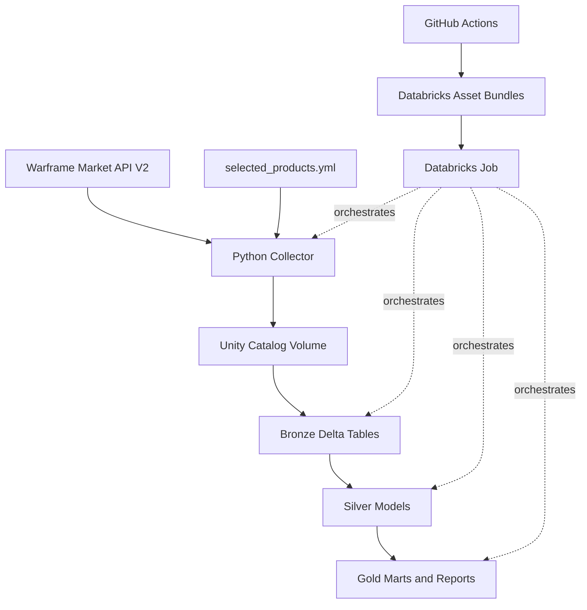

# primo-data-platform

An end-to-end data engineering project built around the **Warframe Market API V2**. The project collects market data, stores raw API responses, transforms them through a Medallion architecture, and prepares curated datasets for market analysis.

The repository currently contains a working Databricks implementation. A second implementation based on PostgreSQL, Airbyte, and dbt is planned as an alternative architecture.

## Project goals

- Collect Warframe Market data through API V2.
- Preserve raw responses and execution metadata for traceability.
- Build a Bronze, Silver, and Gold data model.
- Automate ingestion and transformation workflows.
- Apply version control and CI/CD practices to data infrastructure.
- Compare a Databricks Lakehouse implementation with an open-source ELT stack.

## Current architecture



The current implementation uses Databricks, PySpark, Delta Lake, Unity Catalog, Databricks Asset Bundles, and GitHub Actions.

## Implementation status

### Implemented

- Databricks development environment and Unity Catalog.
- Bronze, Silver, and Gold catalog organization.
- Warframe Market API V2 collector.
- YAML-based product selection.
- Raw JSONL/GZIP storage and execution manifests.
- Bronze ingestion and Silver/Gold transformations.
- Databricks Job with 15 dependent tasks.
- Serverless job environment.
- GitHub Actions CI/CD deployment using a Service Principal.
- Recurring schedule configured for every 30 minutes.

### Planned / in progress

- Validate stability across consecutive scheduled executions.
- Expand monitored products and collection configuration.
- Improve automated data quality tests, alerting, and observability.
- Build a PostgreSQL + Airbyte + dbt implementation.
- Compare both architectures in cost, performance, maintainability, and operational complexity.
- Add analytical consumption examples, including Power BI.

> The complete 15-task Databricks workflow has succeeded in a manual execution. The recurring schedule is enabled, but its long-running stability is still being validated.

## Repository structure

```text
primo-data-platform/
├── config/                  # Collection configuration
├── databricks/
│   ├── 01_bronze/            # Collection and ingestion
│   ├── 02_silver/            # Staging and intermediate models
│   ├── 03_gold/              # Marts and reporting
│   ├── resources/            # Databricks Job resources
│   └── utils/                # Shared notebook configuration
├── .github/
│   └── workflows/            # CI/CD workflows
└── README.md
```

## Scheduling and orchestration

The Databricks workflow contains 15 tasks connected through explicit dependencies. It runs on Databricks Serverless and is configured to execute every 30 minutes (`HH:00` and `HH:30`) in the `America/Sao_Paulo` timezone. Maximum concurrent runs is set to one.

## Alternative architecture

A second implementation is planned using:

```text
Warframe Market API
        ↓
Airbyte custom connector
        ↓
PostgreSQL raw schema
        ↓
dbt staging → intermediate → marts
        ↓
Analytical consumption
```

This path will reproduce the same business outputs to enable a meaningful comparison with the Databricks implementation. It is not yet represented as a completed pipeline.

## Documentation

The detailed technical documentation is maintained separately:

- [`docs/PROJECT_DOCUMENTATION.md`](docs/PROJECT_DOCUMENTATION.md) — architecture, implementation details, data layers, orchestration, CI/CD, configuration, and roadmap.

## Project status

This is an evolving portfolio project focused on practical data engineering: API ingestion, Lakehouse modeling, orchestration, governance, deployment automation, and architecture comparison.
