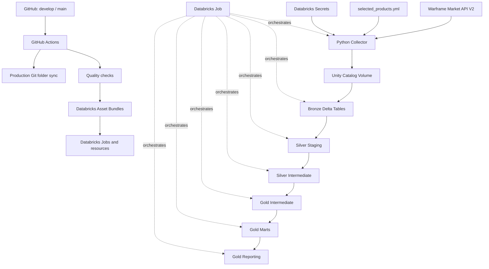

# primo-data-platform

**End-to-end data engineering platform for collecting, processing, and analyzing Warframe Market data.**

The project implements an automated data pipeline around the **Warframe Market API V2**, from API collection and raw-data preservation to curated analytical datasets. Its active implementation runs on **Databricks**, following the Medallion architecture (Bronze, Silver, and Gold), with Git-based development, automated quality checks, and CI/CD deployment through GitHub Actions.

The repository also provides the foundation for a second implementation using PostgreSQL, Airbyte, and dbt, intended to reproduce the same analytical outputs and enable an architectural comparison.


## Project overview

The platform is designed to:

- Collect Warframe Market data through API V2.
- Preserve raw responses and execution metadata for traceability and reprocessing.
- Transform source data through Bronze, Silver, and Gold layers.
- Build facts, dimensions, analytical marts, and reporting datasets.
- Orchestrate and automate ingestion the workflow with Databricks Jobs.
- Apply version control and CI/CD practices to data infrastructure.
- Maintain separate development and production branches and deployment environments.
- Compare a Databricks Lakehouse implementation with an open-source ELT stack.

## Architecture



The current implementation uses Databricks, PySpark, Delta Lake, Unity Catalog, Databricks Asset Bundles, and GitHub Actions.


### Technology stack

| Area | Technologies |
|---|---|
| API ingestion | Python, Warframe Market API V2 |
| Data processing | PySpark, Databricks |
| Storage | Delta Lake, Unity Catalog Volumes |
| Data architecture | Medallion (Bronze, Silver, Gold) |
| Orchestration | Databricks Workflows / Jobs |
| Packaging | Python wheel |
| CI | GitHub Actions, Ruff, pytest |
| CD | Databricks CLI, Databricks Asset Bundles |
| Version control | Git, GitHub (`develop` and `main`) |
| Alternative architecture | PostgreSQL, Airbyte, dbt (planned) |

## Current implementation

### Implemented and operational

- Warframe Market API V2 collector.
- YAML-driven product selection (`config/selected_products.yml`).
- API identification value retrieved from Databricks Secrets.
- Raw JSONL/GZIP files and execution manifests stored in a Unity Catalog Volume.
- Bronze ingestion of API responses and execution metadata.
- Silver staging, intermediate facts, and dimensions.
- Gold intermediate quality model, marts, and reporting datasets.
- Databricks Job with 15 dependent tasks.
- Serverless job environment, Python wheel dependency, queueing, and concurrency control.
- Recurring schedule configured for every 30 minutes.
- GitHub Actions quality gates using Ruff and pytest.
- Databricks Asset Bundles deployment for development and production.
- Branch-based workflow: `develop` for DEV and `main` for PROD.
- Production Git folder synchronization to `main` as part of the production deployment workflow.
- Initial table creation and incremental persistence patterns using Delta writes and `MERGE`.

The complete Databricks workflow has been executed successfully. The project is configured for recurring automated execution, and its deployment workflows are implemented in GitHub Actions.

### Planned improvements

- Implement the equivalent PostgreSQL + Airbyte + dbt pipeline.
- Reconcile outputs between the Databricks and open-source implementations.
- Benchmark execution time, cost, scalability, and operational complexity.
- Expand automated data-quality coverage and operational alerting.
- Add analytical consumption examples, such as Power BI dashboards.

## Databricks data layers

| Layer | Main purpose | Examples |
|---|---|---|
| Bronze | Preserve source data and ingestion metadata | `raw_api_responses`, `execution_manifest`, `item_execution`, `ingestion_log` |
| Silver – Staging | Parse and standardize API entities | `stg_wfm_catalog`, `stg_wfm_orders` |
| Silver – Intermediate | Create analytical facts and dimensions | `fact_order_observation`, `dim_item`, `dim_player`, `dim_execution` |
| Gold – Intermediate | Derive quality indicators | `int_item_price_quality` |
| Gold – Marts | Publish reusable analytical models | `mart_item_price_history`, `mart_item_price_summary` |
| Gold – Reporting | Provide reporting-oriented datasets | `rel_market_overview`, `rel_item_price_history`, `rel_market_quality` |

The detailed model responsibilities, notebook paths, dependencies, and operational design are documented in [`docs/PROJECT_DOCUMENTATION.md`](docs/PROJECT_DOCUMENTATION.md).


## Orchestration

The Databricks Job coordinates **15 tasks** across collection, ingestion, Silver transformations, Gold models, and reporting. Dependencies are declared explicitly, allowing independent tasks to run in parallel after their prerequisites complete.

The recurring schedule is configured with the Quartz expression:

```text
0 0/30 * * * ?
```

- Frequency: every 30 minutes.
- Timezone: `America/Sao_Paulo`.
- Maximum concurrent runs: 1.
- Queueing: enabled.


## CI/CD workflow

The repository uses separate deployment workflows, which run code-quality checks before deployment:

| Branch | Environment | Workflow |
|---|---|---|
| `develop` | Development | `.github/workflows/deploy-dev.yml` |
| `main` | Production | `.github/workflows/deploy-prod.yml` |
        
> OBS: The production workflow additionally validates `DATABRICKS_REPO_PATH`, updates the production Databricks Git folder to branch `main`, and verifies the resulting repository configuration. This is separate from Asset Bundle deployment: the bundle deploys Databricks resources, while the Git folder update synchronizes the checked-out source code.

## Repository structure

```text
primo-data-platform/
├── .github/
│   └── workflows/
│       ├── deploy-dev.yml
│       └── deploy-prod.yml
├── airbyte/
│   └── source-warframe-market/
├── config/
│   └── selected_products.yml
├── databricks/
│   ├── 01_bronze/
│   ├── 02_silver/
│   │   ├── 01_staging/
│   │   └── 02_intermediate/
│   ├── 03_gold/
│   │   ├── 01_intermediate/
│   │   ├── 02_marts/
│   │   └── 03_reporting/
│   ├── resources/
│   └── utils/
├── dbt/
├── docs/
│   └── PROJECT_DOCUMENTATION.md
├── postgres/
├── sql/
│   └── postgres/
├── src/
│   └── primo_market/
├── tests/
├── .env.example
├── Makefile
├── pyproject.toml
├── requirements-dbt.txt
└── README.md
```

## Project status

The Databricks implementation is the operational end-to-end pipeline. It includes automated collection and transformation, scheduled orchestration, version-controlled code, quality gates, and automated deployment.

The next major development milestone is to complete the PostgreSQL + Airbyte + dbt implementation and compare both architectures using equivalent data and business definitions.