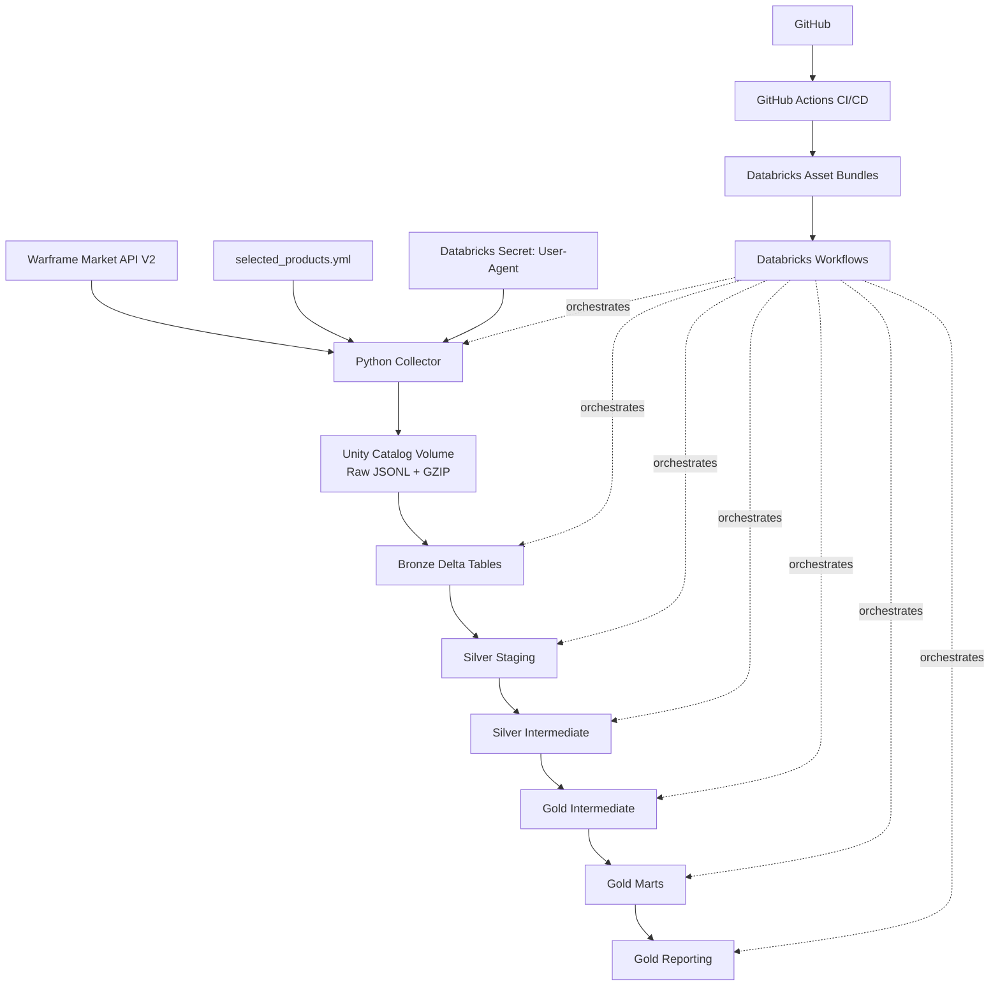
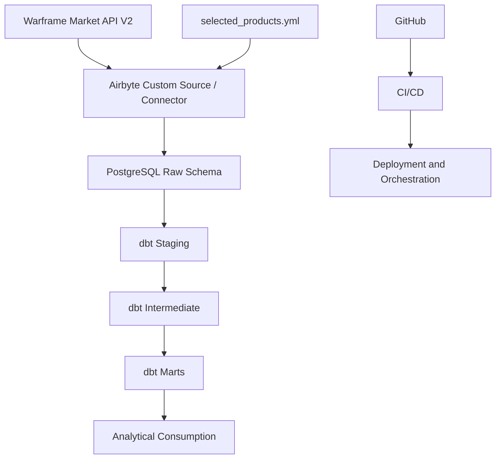
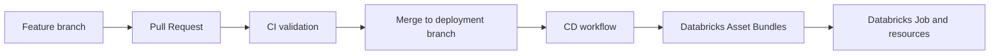

# Project Technical Documentation

This document describes the current implementation of `primo-data-platform`, including its architecture, data flow, Databricks resources, orchestration, CI/CD, and planned extensions.

> **Status convention:** “Implemented” refers to functionality currently present in the Databricks implementation. “Planned” refers to work that has not yet been completed.

---

## 1. Project Overview

`primo-data-platform` is an end-to-end data engineering project built around the Warframe Market API V2.

Its purpose is to collect market information, preserve source responses, transform the data through a Medallion architecture, and expose curated datasets for market analysis.

The project also aims to implement the same analytical pipeline using two different technology stacks:

1. **Databricks Lakehouse:** Python, PySpark, Delta Lake, Unity Catalog, Databricks Workflows, and Asset Bundles.
2. **Open-source ELT stack (planned):** PostgreSQL, Airbyte, and dbt.

The second implementation will make it possible to compare architectural trade-offs using the same source and business requirements.

## 2. Implementation Status

### 2.1 Implemented

- Databricks development workspace configuration.
- Unity Catalog organization for Bronze, Silver, and Gold.
- Unity Catalog Volume for raw files.
- Warframe Market API V2 collector.
- YAML-based selection of monitored products.
- User-Agent retrieval through Databricks Secrets.
- Raw JSONL/GZIP persistence.
- Execution manifest and item-level execution records.
- Bronze Delta ingestion.
- Silver staging and intermediate transformations.
- Gold intermediate models, marts, and reporting tables.
- Databricks Job with 15 tasks and explicit dependencies.
- Serverless execution environment and Python wheel dependency.
- Databricks Asset Bundles deployment.
- GitHub Actions CI/CD using a Service Principal.
- Active 30-minute recurring schedule.

### 2.2 Planned / in progress

- Monitor multiple consecutive scheduled executions and validate operational stability.
- Expand monitored products and collection scope.
- Improve data quality tests and operational alerting.
- Implement the PostgreSQL + Airbyte + dbt alternative.
- Compare cost, performance, maintainability, and operational complexity.
- Add analytical consumption examples, including Power BI.
- Define and deploy a production environment.

A complete manual run of the 15-task workflow succeeded. The recurring schedule has been enabled, but successful scheduled operation over time still needs to be verified.

---

## 3. Architecture

### 3.1 Current architecture — Databricks



The Databricks implementation is the currently operational path. It uses:

- **Databricks:** execution environment and workflow orchestration.
- **PySpark:** distributed transformations.
- **Delta Lake:** storage format for structured tables.
- **Unity Catalog:** data organization, access control, and governance.
- **Python:** API collection and reusable application logic.
- **Databricks Asset Bundles:** deployment of notebooks and resources.
- **GitHub Actions:** automated validation and deployment.

### 3.2 Planned alternative — PostgreSQL, Airbyte, and dbt



This architecture is planned. It is intended to reproduce the same business logic and analytical outputs rather than serve as a separate source of business definitions.

---

## 4. Databricks Environment

### 4.1 Unity Catalog

The development environment is organized into three catalogs:

| Catalog | Medallion layer | Purpose |
|---|---|---|
| `dev_bronze` | Bronze | Raw ingested data and execution metadata |
| `dev_silver` | Silver | Cleaned, standardized, and modeled data |
| `dev_gold` | Gold | Analytical marts and reporting datasets |

The primary Bronze schema is:

```text
dev_bronze.warframe_market
```

### 4.2 Unity Catalog Volume

Raw collection files are stored in:

```text
/Volumes/dev_bronze/warframe_market/raw/
```

The Volume separates raw file persistence from the structured Delta tables created by the ingestion notebooks.

### 4.3 Secrets

The collector retrieves its API identification value at runtime.

| Setting | Value |
|---|---|
| Secret scope | `warframe-market` |
| Secret key | `wfm_user_agent` |

The secret value is not stored in the Git repository.

### 4.4 Runtime and Job environment

The official development Job uses:

| Property | Configuration |
|---|---|
| Compute | Databricks Serverless |
| Environment key | `primo_market_env` |
| Environment version | `5` |
| Maximum concurrent runs | `1` |
| Queueing | Enabled |
| Timeout | 3,600 seconds |

The Job uses the project Python wheel as a dependency.

---

## 5. Bronze Layer: Collection and Ingestion

### 5.1 Product configuration

The monitored product list is maintained outside the collector code:

```text
config/selected_products.yml
```

The Job passes this file to the collection notebook through the `products_file` parameter. This makes it possible to change the monitored products without changing the collector's core implementation.

The initial monitored sets include:

| Product | API identifier |
|---|---|
| Soma Prime | `soma_prime_set` |
| Limbo Prime | `limbo_prime_set` |

The collector discovers the component items for each selected set and collects order data for those items.

### 5.2 Collector notebook

```text
databricks/01_bronze/00_collect_warframe_market.ipynb
```

The collector performs the following steps:

1. Loads the shared notebook configuration.
2. Reads the selected products file.
3. Retrieves the User-Agent from Databricks Secrets.
4. Calls Warframe Market API V2.
5. Discovers component items associated with each selected set.
6. Collects order data for the discovered items.
7. Persists raw responses and execution metadata to the Unity Catalog Volume.

### 5.3 Raw output

The collector stores compressed JSON Lines files. The format preserves individual records and supports downstream ingestion and reprocessing.

The execution output includes:

- `manifest.json`
- `item_execution.jsonl.gz`
- `raw_api_responses.jsonl.gz`

### 5.4 Ingestion notebooks

```text
databricks/01_bronze/01_ingest_warframe_market.ipynb
databricks/01_bronze/02_ingest_execution_manifest.ipynb
```

The first notebook ingests API responses. The second ingests execution-level metadata.

### 5.5 Bronze tables

| Table | Purpose |
|---|---|
| `dev_bronze.warframe_market.execution_manifest` | One record per collection execution |
| `dev_bronze.warframe_market.ingestion_log` | Ingestion status and operational metadata |
| `dev_bronze.warframe_market.item_execution` | Per-item collection results |
| `dev_bronze.warframe_market.raw_api_responses` | Raw API response records |

The separation between raw responses, item-level execution results, and execution manifests provides traceability from a downstream dataset back to its collection run.

---

## 6. Silver Layer

The Silver layer standardizes source data and structures it for analytical use. It is divided into staging and intermediate models.

### 6.1 Staging

| Notebook | Responsibility |
|---|---|
| `databricks/02_silver/01_staging/01_stg_wfm_catalog.ipynb` | Standardizes catalog and item metadata |
| `databricks/02_silver/01_staging/02_stg_wfm_orders.ipynb` | Standardizes market order observations |

### 6.2 Intermediate models

| Notebook | Model | Responsibility |
|---|---|---|
| `databricks/02_silver/02_intermediate/01_fact_order_observation.ipynb` | `fact_order_observation` | Structures order observations for analysis |
| `databricks/02_silver/02_intermediate/02_dim_item.ipynb` | `dim_item` | Item dimension |
| `databricks/02_silver/02_intermediate/03_dim_player.ipynb` | `dim_player` | Player dimension |
| `databricks/02_silver/02_intermediate/04_dim_execution.ipynb` | `dim_execution` | Collection execution dimension |

The intermediate layer separates measurable observations from descriptive entities and execution metadata.

---

## 7. Gold Layer

The Gold layer contains quality calculations, analytical marts, and reporting-oriented datasets.

### 7.1 Intermediate quality model

| Notebook | Model | Responsibility |
|---|---|---|
| `databricks/03_gold/01_intermediate/01_int_item_price_quality.ipynb` | `int_item_price_quality` | Calculates price and observation quality indicators |

### 7.2 Marts

| Notebook | Model | Responsibility |
|---|---|---|
| `databricks/03_gold/02_marts/01_mart_item_price_history.ipynb` | `mart_item_price_history` | Historical item price observations |
| `databricks/03_gold/02_marts/02_mart_item_price_summary.ipynb` | `mart_item_price_summary` | Aggregated price summaries |

### 7.3 Reporting models

| Notebook | Model | Responsibility |
|---|---|---|
| `databricks/03_gold/03_reporting/01_rel_market_overview.ipynb` | `rel_market_overview` | Market-level overview |
| `databricks/03_gold/03_reporting/02_rel_item_price_history.ipynb` | `rel_item_price_history` | Item-level historical reporting |
| `databricks/03_gold/03_reporting/03_rel_market_quality.ipynb` | `rel_market_quality` | Market data quality reporting |

The Gold layer is intended to support price behavior analysis over time, item comparisons, market summaries, and evaluation of the coverage and quality of collected observations.

---

## 8. Workflow Orchestration

The Databricks Job contains 15 tasks connected through explicit dependencies.

| # | Task key | Responsibility |
|---:|---|---|
| 1 | `collect_warframe_market` | Collect data from the API |
| 2 | `ingest_warframe_market` | Ingest raw API responses |
| 3 | `ingest_execution_manifest` | Ingest execution metadata |
| 4 | `stg_wfm_catalog` | Build catalog staging |
| 5 | `stg_wfm_orders` | Build orders staging |
| 6 | `dim_item` | Build item dimension |
| 7 | `dim_player` | Build player dimension |
| 8 | `dim_execution` | Build execution dimension |
| 9 | `fact_order_observation` | Build order observation fact |
| 10 | `int_item_price_quality` | Calculate quality indicators |
| 11 | `mart_item_price_history` | Build price history mart |
| 12 | `mart_item_price_summary` | Build price summary mart |
| 13 | `rel_market_overview` | Build market overview reporting |
| 14 | `rel_item_price_history` | Build item price history reporting |
| 15 | `rel_market_quality` | Build market quality reporting |

Independent tasks can run in parallel after their dependencies have completed.

### 8.1 Schedule

The Job is configured with the following Quartz expression:

```text
0 0/30 * * * ?
```

| Property | Value |
|---|---|
| Frequency | Every 30 minutes |
| Expected start times | `HH:00` and `HH:30` |
| Timezone | `America/Sao_Paulo` |
| Schedule status | Unpaused |
| Maximum concurrent runs | 1 |
| Queueing | Enabled |

### 8.2 Manual execution validation

A complete manual execution of the 15-task workflow succeeded:

- Parent run ID: `932408710386695`
- Tasks completed successfully: 15/15
- Total duration: approximately 5 minutes and 39 seconds

The recurring schedule was enabled after this validation. Consecutive scheduled runs must still be monitored to establish operational stability.

---

## 9. CI/CD and Infrastructure Deployment

### 9.1 Deployment flow



### 9.2 Main components

- GitHub repository and branch-based development.
- GitHub Actions workflows for CI and CD.
- Databricks CLI.
- Databricks Asset Bundles.
- Service Principal authentication.
- Databricks Job and notebook resources.

The Databricks bundle configuration is located in:

```text
databricks/
```

### 9.3 Deployment identity

The official development Job is deployed and managed by a Service Principal through GitHub Actions.

This separates automated deployment from personal developer credentials and gives the official Job a stable execution and management identity.

A local deployment authenticated with a personal Databricks account can create a separate user-owned bundle deployment. That personal deployment is distinct from the official Service Principal-managed Job.

---

## 10. Planned PostgreSQL + Airbyte + dbt Implementation

The second implementation will reproduce the source collection and analytical transformations using a relational and open-source ELT architecture.

### 10.1 Planned flow

1. Build or adapt an Airbyte source connector for Warframe Market API V2.
2. Configure product selection and API request behavior.
3. Persist raw source data in PostgreSQL.
4. Create dbt staging models to standardize the source.
5. Recreate intermediate entities and facts.
6. Recreate Gold marts and reporting datasets.
7. Add tests, documentation, and orchestration.
8. Compare results against the Databricks implementation.

### 10.2 Comparison dimensions

The comparison should use equivalent source data, collection scope, and business definitions.

| Dimension | Questions to evaluate |
|---|---|
| Architecture | How are ingestion, transformation, and orchestration separated? |
| Performance | How long do equivalent workloads take? |
| Cost | What are the infrastructure and compute costs? |
| Scalability | How does each stack behave as products and observations grow? |
| Reliability | How are retries, failures, and partial executions handled? |
| Maintainability | How easy is it to test, change, and deploy the pipeline? |
| Governance | How are permissions, lineage, and data documentation managed? |
| Developer experience | How easy is local development and debugging? |

This implementation is planned and is not yet a deployed alternative pipeline.

---

## 11. Local Development

The repository is developed locally and deployed to Databricks through the Databricks CLI and Asset Bundles.

Typical development activities include:

- Editing notebooks and Python package code.
- Updating `config/selected_products.yml`.
- Running local tests and static checks.
- Validating Databricks bundle configuration.
- Submitting changes through feature branches and pull requests.
- Deploying through the CI/CD workflow.

The exact local setup commands should be maintained alongside the repository's dependency and bundle configuration so that they remain aligned with the current implementation.

---

## 12. Monitoring and Operational Checks

Operational validation should cover both the workflow and the data it produces.

### 12.1 Job checks

- Confirm the scheduled run starts at the expected time.
- Confirm all 15 tasks complete successfully.
- Review task duration and failure messages.
- Verify that concurrent runs do not overlap.
- Monitor consecutive executions rather than relying on a single successful run.

### 12.2 Bronze checks

Validate that each collection execution produces:

- An execution manifest.
- Item-level execution records.
- Raw API response records.
- A corresponding ingestion log.
- Consistent execution identifiers and timestamps.

Example query to inspect recent executions:

```sql
SELECT *
FROM dev_bronze.warframe_market.execution_manifest
ORDER BY started_at DESC
LIMIT 20;
```

Example query to inspect ingestion outcomes:

```sql
SELECT *
FROM dev_bronze.warframe_market.ingestion_log
ORDER BY ingestion_timestamp DESC
LIMIT 20;
```

Column names may need to be adjusted if the physical table schema changes.

---

## 13. Roadmap

### Near term

- [ ] Observe and validate consecutive scheduled runs.
- [ ] Review failure handling, retries, and ingestion idempotency.
- [ ] Expand collection configuration and monitored products.
- [ ] Add automated data quality checks and operational alerts.
- [ ] Improve technical documentation and data lineage.

### Medium term

- [ ] Implement the PostgreSQL + Airbyte + dbt pipeline.
- [ ] Reconcile outputs between both implementations.
- [ ] Benchmark performance and operational cost.
- [ ] Add analytical dashboards and consumption examples.

### Longer term

- [ ] Establish production deployment and environment promotion.
- [ ] Expand historical analysis and market indicators.
- [ ] Publish a structured architecture comparison.

---

## 14. Project Structure

The main repository areas are organized as follows:

```text
primo-data-platform/
├── config/
│   └── selected_products.yml
├── databricks/
│   ├── 01_bronze/
│   ├── 02_silver/
│   │   ├── 01_staging/
│   │   └── 02_intermediate/
│   ├── 03_gold/
│   │   ├── 01_intermediate/
│   │   ├── 02_marts/
│   │   └── 03_reporting/
│   ├── resources/
│   └── utils/
├── .github/
│   └── workflows/
├── docs/
│   └── PROJECT_DOCUMENTATION.md
└── README.md
```

This is a logical overview of the main areas; auxiliary package, test, and tooling files may also exist in the repository.

---

## 15. Project Status Summary

The Databricks implementation currently provides a working end-to-end path from Warframe Market API V2 collection through Bronze ingestion, Silver transformations, Gold marts, and reporting models. Its 15-task workflow has completed successfully in a manual run, and recurring execution is configured.

The next priorities are to validate scheduled operation over time, strengthen quality and monitoring, and implement the PostgreSQL + Airbyte + dbt alternative so both architectures can be compared using equivalent requirements and outputs.
